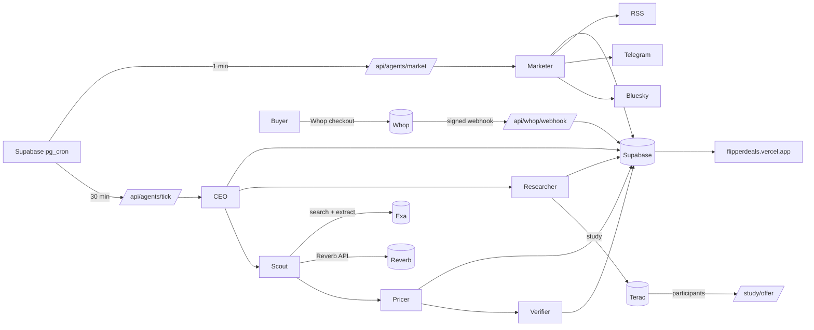

# Flipper

**An agent-run resale deal company.** Flipper finds second-hand listings priced below what the same item resells for, proves it with comps, and sells those deals to flippers through Whop. Agents find the deals, price them, check them, market them, take payment, and change the product based on what real people tell them.

- **Live:** https://flipperdeals.vercel.app
- **Whop business:** Flipper, `biz_YPrH61Cai9ZjFZ`
- **Built for:** Terac Zero Human Hackathon, NYC, Oct 24 2026

## What it sells (on Whop)

| Product | Price | What you get |
|---|---|---|
| **Flipper Check** | $7 per check | Paste any listing link. Get **BUY**, **PASS** or **OFFER $X**, with comps, fees, net profit and a confidence score. |
| **Founding Seat** | $49 one-time, capped at 50 | Every verified deal with its listing link 24 hours before the public sees it, in a members feed. The cap means members aren't all racing for the same listing. |

Payments run entirely on Whop checkout. A signed webhook records each payment and unlocks Checks or members access.

## The agents

Each agent is a module in [`agents/`](agents) with a `run()` function. Every action goes to `agent_logs` and every judgment call to `decisions`, with reasoning. Both show on `/admin`.

| Agent | Job | Runs | Built on |
|---|---|---|---|
| **CEO** ([ceo.ts](agents/ceo.ts)) | Orchestrates each cycle, sets budgets, approves Terac and ad spend, reviews the watchlist with Claude, logs hard decisions | every 30 min | Claude, Supabase |
| **Scout** ([scout.ts](agents/scout.ts)) | Finds candidate listings: Reverb's catalog (exact-product comparison pages) plus allowed resale sites through **Exa** (furniture, clothing, sneakers, watches, cameras, electronics, cars) | every 30 min | Reverb API, **Exa** search with structured extraction, eBay Browse API (ready, pending eBay approval) |
| **Pricer** ([pricer.ts](agents/pricer.ts), [pricing.ts](lib/pricing.ts)) | Market value = median of comparable listings, outliers removed (× 0.82 when only live listings exist). Subtracts fees, shipping and a safety buffer. Only posts deals with ≥ $20 net, ≥ 30% ROI and ≥ 60 confidence. | every 30 min | unit-tested math |
| **Verifier** ([verifier.ts](agents/verifier.ts)) | Re-reads every live deal; expires it if sold, removed or repriced above the buy price | every 30 min | Reverb API, **Exa** live crawl |
| **Marketer** ([marketer.ts](agents/marketer.ts)) | Posts real deals, 24-hour recaps and Check pitches to every connected channel, with spacing per channel; every link is tracked; pings search engines through IndexNow | **every minute** | Claude for copy, Bluesky, Telegram, Mastodon and Discord adapters, RSS |
| **Researcher** ([researcher.ts](agents/researcher.ts)) | Runs **Terac** studies, scores the answers, and ships the winning product change with a before/after | every 30 min | **Terac** MCP, its own task pages |
| **Sales / payments** ([webhook](app/api/whop/webhook/route.ts), [check](app/api/check/route.ts)) | Verifies Whop's webhook signature, records revenue, delivers Check verdicts, gates the members feed | on each payment | **Whop** |
| **Compliance** ([legal](app/legal/[doc]/page.tsx)) | Terms, refund policy, disclaimer (not financial advice, no guaranteed profit). Sources only official APIs and Exa; never scrapes Facebook Marketplace, Vinted, Mercari, Poshmark, Depop or Grailed. | always | |

## Fully autonomous: who does what

| The hackathon asks for | Who does it | Evidence |
|---|---|---|
| Building the product | Scout, Pricer and Verifier rebuild the deal feed every 30 min; the Researcher changes the homepage from Terac results | `agent_logs`, `/deals`, homepage variant |
| Marketing & outbound | The Marketer posts every few minutes across channels, tracks clicks, pings search engines | `posts` table with clicks, [Bluesky](https://bsky.app), [Telegram](https://t.me/tryflipperdeals) |
| Selling to customers | Whop checkout, the members window, the $7 Check | `/check`, `/members` |
| Handling payments | Signed Whop webhook → `revenue_events` → access granted | `/admin` revenue counter |
| Legal / compliance | Terms, refunds and disclaimer pages; banned sources never touched | `/legal/*` |
| Hard decisions | The CEO logs every spend and threshold call with reasoning | `decisions` on `/admin` |

Scheduling runs inside Supabase with no human in the loop: `pg_cron` calls `/api/agents/tick` every 30 minutes and `/api/agents/market` every minute. The bearer token for those calls is generated and kept in Supabase Vault.

## Human in the loop: Terac

1. **The CEO decides it needs people.** It asks whether the offer page is clear and trusted, or whether a proof-first page would sell better.
2. **Quote before spend.** Terac estimated $6 per participant, so 20 people would cost $120: over both the $35 study cap and the $100 balance. The CEO cut it to 5 people for $30 and logged why.
3. **The study is live**, open to the US general population (adults who've bought or sold second-hand online). Participants compare two homepages on [`/study/offer`](app/study/offer), rate clarity, trust and willingness to pay, pick one and explain why. Answers land in `study_responses`, and the page returns them to Terac to mark the submission complete.
4. **The product changes by itself.** Once 3 answers are in, the Researcher scores both versions, writes the before/after to `terac_studies`, and switches the live homepage if version B wins.

| Metric (1–5, % preferred) | Before: page A | After: winner |
|---|---|---|
| Clarity | _pending_ | _pending_ |
| Trust | _pending_ | _pending_ |
| Would pay | _pending_ | _pending_ |
| Preferred | _pending_ | _pending_ |

_Terac spend: $30 of $100. Remaining credit is reserved for a deal-appeal study and a re-test of the winner._

## Exa

Exa is how Flipper sees beyond the marketplaces that have APIs:
- **Sourcing:** searches allowed resale sites (Chairish, 1stDibs, Kaiyo, KEH, MPB, Swappa, Back Market, Chrono24, The RealReal, thredUP, cars.com, Autotrader, eBay pages). A JSON-schema summary extracts each listing's price, currency, condition, and whether it's for sale or an auction. Only fixed-price USD listings count.
- **Verification:** live-crawls each web deal to check it's still for sale at that price.
- **Flipper Check on any link:** reads the page's price, then finds the same item elsewhere for comps.

To control credit use, Scout scans a rotating slice of 6 searches per cycle instead of every category every time.

## Numbers so far (live, Oct 24 ~2 PM ET)

- **79** live deals, **$13,874** est. net profit found, 2 expired by the Verifier
- **34** posts (Bluesky 14, Telegram 12, RSS 8), **117** tracked clicks (some are link-preview fetches)
- **101** logged agent actions, CEO decisions logged with reasoning
- **Revenue:** $0 so far (see `/admin` for the live counter)

## Architecture



**Stack:** Next.js 16 (App Router, Cache Components) on Vercel · Supabase Postgres with pg_cron, pg_net and Vault · Claude (`claude-sonnet-5-5`) · Exa · Terac · Whop.

## Post-hackathon

- **Seat cap as a moat:** 50 seats per deal feed. When it fills, open a second feed per category (furniture, cameras, cars), so members never all compete for one listing.
- **The Check scales with no extra supply:** every pasted link is revenue, and it works on any site Exa can read.
- **Recurring revenue:** move Seats to $49/mo once the track record shows realized profit per member.
- **More sources:** the eBay Browse API is already built and waiting on eBay approval, which multiplies non-music supply.
- **Not done yet:** Solari screenshot verification ([`workers/solari`](workers)) is waiting on a key.

## Run it

```bash
npm install
cp .env.example .env.local   # fill in the keys; never commit them
npm run dev                  # http://localhost:3000
npm test                     # pricing, webhook parsing, study scoring
npx tsx --env-file=.env.local scripts/dry-run.ts   # one Scout + Pricer pass, no writes
```

Database schema is in [`supabase/migrations`](supabase/migrations).
